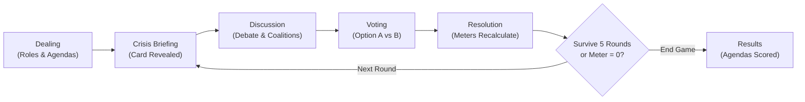

<div align="center">

# 🏛️ The Boardroom Coup

**A high-stakes corporate crisis simulation & asymmetric social deduction game.**

2–8 Players • ~15–20 Minutes • Zero Account Friction • Real-Time WebSockets

[](https://nodejs.org/)
[](https://www.typescriptlang.org/)
[](https://react.dev/)
[](https://vitejs.dev/)
[](https://developer.mozilla.org/en-US/docs/Web/API/WebSocket)
[](https://render.com/)

</div>

---

## 📋 Executive Overview

**The Boardroom Coup** drops players into the boardroom seats of an embattled global corporation on the brink of financial, legal, and reputational ruin.

On every crisis turn, an existential event strikes the company—from accounting fraud and ransomware extortion to catastrophic product recalls and hostile takeover bids. While the entire board publicly observes the corporation's vital signs (*Budget*, *Public Trust*, and *Morale*), every director holds a **confidential corporate agenda** and an **assigned executive title** (CEO, CFO, General Counsel, Audit Chair, etc.).

Will you act as a faithful fiduciary fighting to keep the enterprise solvent, an opportunist engineering a golden parachute, or a corporate raider stripping company assets before liquidation?

---

## ⚡ Core Features

- **🎮 2–8 Player Dynamic Scalability**: Instant room creation with simple room codes; zero sign-up or registration required.
- **📈 Real-Time Vital Signs**: Track company health across **Budget**, **Public Trust**, and **Morale** (0–100). If any vital sign hits 0, the company enters immediate liquidation collapse!
- **🃏 14 Canonical Crisis Scenarios**: High-stakes dilemmas with asymmetric trade-offs and tiebreaker resolutions.
- **🕵️ 12 Confidential Agendas**: Asymmetric win conditions spanning Fiduciary Turnarounds, Short-Sellers, Whistleblowers, Corporate Raiders, and People's Champions.
- **🗳️ Weighted Influence Voting**: Spend limited influence points to sway critical boardroom ballots.
- **🖥️ Bloomberg Executive Theme System**: Default Obsidian Dark terminal aesthetic with instant toggle to High-Contrast Light Mode.
- **🔊 Procedural Audio Engine**: Asset-free, synthesized soundscapes powered entirely by the Web Audio API.
- **🛡️ Authoritative State Isolation**: Authoritative server with strict public vs. private state masking, eliminating client-side inspection exploits.

---

## 🏗️ Architecture & Monorepo Structure

```
The-Boardroom-Coup/
├── apps/
│   ├── server/           # Node.js + Express + WebSocket authoritative engine
│   │   ├── src/
│   │   │   ├── auth/     # Session tokens & connection credentials
│   │   │   ├── rooms/    # Room lifecycle, voting logic, and timer worker
│   │   │   ├── realtime/ # WebSocket gateway & message dispatch
│   │   │   └── index.ts  # Express server, static asset host, and health check
│   │   └── package.json
│   └── web/              # React 18 + Vite client application
│       ├── src/
│       │   ├── app/      # Screen components (Home, Lobby, Match, Results)
│       │   ├── hooks/    # Reactive WebSocket game state hooks
│       │   ├── services/ # Sound synthesizer & WebSocket client
│       │   └── state/    # Global game store & action reducers
│       ├── vite.config.ts
│       └── package.json
├── packages/
│   ├── contracts/        # Shared TypeScript types & Zod validation schemas
│   └── game-content/     # Canonical crisis deck (14 cards) & agendas (12 roles)
├── render.yaml           # 1-Click Render Blueprint deployment configuration
├── .env.example          # Environment variable template
└── package.json          # Root orchestration & build scripts
```

---

## 🚀 Quick Start (Local Development)

### Prerequisites

- **Node.js**: `v18.0.0` or higher
- **npm**: `v9.0.0` or higher

### 1. Clone & Install Dependencies

```bash
git clone https://github.com/<your-username>/the-boardroom-coup.git
cd the-boardroom-coup

# Install all dependencies across the entire monorepo
npm install
```

### 2. Start Local Development Servers

Run both the backend WebSocket engine and frontend Vite server concurrently:

```bash
npm run dev
```

The servers will start on:
- 🌐 **Frontend Client**: [http://localhost:5173](http://localhost:5173)
- 🔌 **Backend WebSocket & API**: [http://localhost:3001](http://localhost:3001)
- ❤️ **Health Check Endpoint**: [http://localhost:3001/health](http://localhost:3001/health)

### 3. Simulating a Multiplayer Game Locally

1. Open [http://localhost:5173](http://localhost:5173) in your primary browser window.
2. Enter your name and click **Create Boardroom** to get a 4-character Room Code.
3. Open an **Incognito / Private Window** (or a second browser like Chrome / Firefox / Edge).
4. Go to [http://localhost:5173](http://localhost:5173), enter a second player name, type in the Room Code, and click **Join Boardroom**.
5. Both players click **Ready** → The host clicks **Start Simulation**!

---

## 📦 Production Build & Testing

Test the full production build locally before deploying:

```bash
# 1. Compile shared packages, server, and client bundle
npm run build

# 2. Run the unified production server
npm start
```

In production mode, the Express backend serves the compiled React application directly from `apps/web/dist` alongside the WebSocket gateway on a single unified port:
- Open [http://localhost:3001](http://localhost:3001) to experience the unified production build.

---

## ☁️ Deployment Guide (Render)

This application is pre-configured for seamless deployment to **[Render](https://render.com/)** in one go. The server handles both the WebSocket gateway and the compiled static frontend on a single port.

### Option A: 1-Click Blueprint (Recommended)

1. Push your repository to **GitHub**.
2. Go to [Render Dashboard](https://dashboard.render.com/) and click **New +** → **Blueprint**.
3. Select your repository.
4. Render will detect the included [`render.yaml`](render.yaml) file and provision:
   - **Environment**: Node
   - **Plan**: Free
   - **Build Command**: `npm install --include=dev && npm run build`
   - **Start Command**: `npm start`
   - **Health Check**: `/health`
5. Click **Apply** to deploy!

### Option B: Manual Web Service

1. Go to [Render Dashboard](https://dashboard.render.com/) and click **New +** → **Web Service**.
2. Connect your GitHub repository.
3. Configure settings:
   - **Name**: `the-boardroom-coup`
   - **Runtime**: `Node`
   - **Build Command**: `npm install --include=dev && npm run build`
   - **Start Command**: `npm start`
   - **Health Check Path**: `/health`
4. Add the following **Environment Variable**:
   - `NODE_ENV` = `production`
5. Click **Create Web Service**.

---

## ⚙️ Environment Variables

| Variable | Default | Purpose |
| :--- | :--- | :--- |
| `PORT` | `3001` | HTTP and WebSocket server port (assigned automatically by cloud hosts). |
| `NODE_ENV` | `development` | Setting to `production` enables static asset serving and optimized CORS. |
| `CLIENT_ORIGIN` | `http://localhost:5173` | *(Optional)* Comma-separated allowed origins for cross-domain deployments. |
| `VITE_WS_URL` | *Auto-detected* | *(Optional)* Explicit WebSocket URL override for custom CDNs. |

---

## 📜 Available Scripts

| Command | Action |
| :--- | :--- |
| `npm run dev` | Starts server watch mode (`tsx`) and client dev server (`vite`) concurrently. |
| `npm run build` | Compiles `@boardroom/contracts`, `@boardroom/game-content`, server, and client. |
| `npm start` | Launches the production Node.js server from `apps/server/dist/index.js`. |
| `npm test` | Runs the test suite via Jest. |

---

## 🎯 Gameplay Rules & Round Lifecycle



1. **Crisis Briefing**: A canonical crisis card is drawn affecting company vital signs.
2. **Executive Debate**: Directors debate strategy. Influence points can be reserved or committed.
3. **Ballot Cast**: Board members secretly submit their vote: **Option A**, **Option B**, or **Abstain**, accompanied by optional **Influence Points** to weight the outcome.
4. **Resolution**: Votes are tallied, tiebreakers resolved, and vital signs updated in real-time.
5. **Final Reckoning**: If the company survives 5 rounds without any meter dropping to 0, surviving fiduciaries celebrate; otherwise, raiders and liquidators claim the wreckage.

---

## ⚖️ License

Private repository. All rights reserved. Built for corporate strategy simulation and social deduction enthusiasts.
